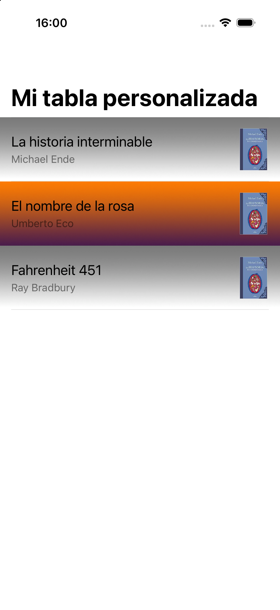
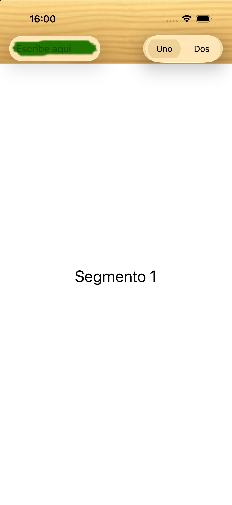

# 2- Guías de estilo y personalización

En esta sesión veremos primero las recomendaciones de diseño de _Apple_ (las
_Human Interface Guidelines_, o HIG) y después cómo personalizar el aspecto de listas
y barras en _SwiftUI_.

## Guías de estilo en iOS

Apple publica sus recomendaciones de diseño en las
<a href="https://developer.apple.com/design/human-interface-guidelines/">Human Interface Guidelines</a>.
No son una norma de obligado cumplimiento, pero conviene conocerlas: una app que se
sale de ellas sin motivo resulta extraña al usuario, y puede ser rechazada en la
revisión de la _App Store_.

### Principios de diseño

Los principios que Apple viene manteniendo son tres:

* **Claridad**. El texto debe ser legible a cualquier tamaño, los iconos precisos, los
  adornos escasos. El espacio en blanco, el color y la tipografía deben destacar el
  contenido importante y facilitar la interacción.
* **Deferencia** (_deference_). El interfaz está al servicio del contenido, no al
  revés. Los elementos de la interfaz deben ser ligeros y no competir con lo que el
  usuario ha venido a ver.
* **Profundidad**. Las capas visuales y las transiciones ayudan a entender la
  jerarquía de la aplicación y dan sensación de continuidad al navegar.

En la práctica, lo que debe cumplir una aplicación es:

* **Integridad estética**: el aspecto visual debe encajar con lo que la app hace. Un
  juego puede permitirse una interfaz vistosa; una app de contabilidad, no.
* **Consistencia**: usar los elementos estándar que el usuario ya conoce, y mantener
  un diseño uniforme en toda la app.
* **Adaptabilidad**: la pantalla debe responder al giro del dispositivo, al modo
  oscuro y al tamaño de letra que el usuario haya elegido en los ajustes del sistema.
* **_Feedback_**: hay que confirmar las acciones y mostrar sus resultados.

Antes de diseñar conviene saber a qué público va dirigida la app, y hacer un diseño previo con herramientas de _mockups_ como <a href="https://playmockup.com">Play</a> o <a href="https://balsamiq.com">Balsamiq</a>, aunque usando Preview en SwiftUI suele ser suficiente.

### Liquid Glass: el rediseño de iOS 26

iOS 26 introdujo **Liquid Glass**, el cambio de aspecto más profundo del sistema desde iOS 7. Los controles y las barras se dibujan ahora sobre un material translúcido que refracta y refleja el contenido que tienen debajo, y adoptan formas de cápsula con esquinas muy redondeadas.

Para el desarrollo, lo importante no es el efecto en sí sino sus **consecuencias
prácticas**:

* **El contenido manda todavía más.** El material de las barras es translúcido y deja
  ver lo que hay detrás. Conviene que el contenido llegue por debajo de las barras en
  lugar de dejar franjas opacas.
* **Los controles estándar se adaptan solos.** Un `Button`, un `Picker` o una `List`
  adoptan el aspecto nuevo sin tocar nada, y seguirán adaptándose en futuras versiones.
* **La personalización que pelea con el sistema se rompe.** Esta es la lección
  importante, y la veremos en el segundo ejercicio. Intentar imponer un aspecto
  colocando vistas por debajo de una barra, o manipulando las vistas internas de un
  control, deja de funcionar o produce resultados ilegibles en cuanto el sistema
  cambia de aspecto. Lo que se personaliza por los puntos previstos sigue
  funcionando.

!!! warning "La regla práctica"
    Personaliza **a través de los modificadores que ofrece el sistema**
    (`.tint`, `.background`, `.foregroundStyle`, `.toolbarBackground`…). Si para
    conseguir un efecto necesitas inspeccionar o manipular las vistas internas de un
    componente, es muy probable que se rompa en la siguiente versión de iOS.

### Adaptabilidad: modo oscuro y tamaño de letra

Dos ajustes que el usuario controla desde el sistema y que tu app debe respetar.

**Modo oscuro.** No uses colores absolutos. En lugar de `Color.black` o `Color.white`, usa los colores semánticos, que ya se adaptan:

```swift
Text("Título")
    .foregroundStyle(.primary)       // se adapta a claro/oscuro
Text("Subtítulo")
    .foregroundStyle(.secondary)
```

Puedes comprobarlo en la _preview_ sin tocar el simulador:

```swift
#Preview("Oscuro") {
    ContentView().preferredColorScheme(.dark)
}
```

**Tamaño de letra dinámico** (_Dynamic Type_). Si usas los estilos del sistema
(`.title`, `.body`, `.caption`…) en lugar de tamaños fijos, el texto crecerá cuando el
usuario aumente el tamaño de letra en los ajustes:

```swift
Text("Se adapta").font(.body)          // bien
Text("No se adapta").font(.system(size: 17))   // evítalo
```

### Accesibilidad

Es mucho más fácil tenerla en cuenta desde el principio que añadirla después. Lo
mínimo:

* Poner una descripción a las imágenes que transmiten información, para que
  _VoiceOver_ pueda leerlas:

```swift
Image("portada")
    .accessibilityLabel("Portada de La historia interminable")
```

* Las imágenes puramente decorativas se marcan para que _VoiceOver_ las ignore:

```swift
Image("fondo").accessibilityHidden(true)
```

* Mantener contraste suficiente entre texto y fondo. Esto es especialmente relevante
  al poner imágenes de fondo, como haremos en los ejercicios de esta sesión.

### Componentes disponibles

En <a href="https://developer.apple.com/design/human-interface-guidelines/components/all-components">este enlace</a>
están todos los componentes del sistema. Se agrupan en:

* **Contenido**: para mostrar texto, imágenes, gráficos o contenido web.
* **Distribución y organización**: listas, rejillas, tablas, secciones.
* **Menús y acciones**: botones, menús, _pop-ups_.
* **Navegación y búsqueda**: barras de navegación, _tab bars_, campos de búsqueda.
* **Presentación**: alertas, hojas modales, _popovers_, controles de página.
* **Selección y entrada**: _pickers_, _toggles_, _sliders_, campos de texto.
* **Estado**: barras de progreso, medidores.
* **Experiencias del sistema**: notificaciones, _widgets_, barra de estado.

---

## Personalización en SwiftUI

Personalizar es modificar el aspecto visual de los componentes estándar. Por norma
general **no se recomienda**, porque confunde al usuario, pero hay casos donde es
necesario: juegos, apps con identidad de marca propia, o listas donde cada fila debe
mostrar información estructurada.

La personalización de las celdas de una lista es la excepción: es algo completamente
habitual en iOS, y es con lo que empezaremos.

---

## Ejercicio 1 - Personalización de celdas

Vamos a construir una lista de libros donde cada fila muestra la portada, el título y
el autor, con un fondo que alterna entre dos imágenes (efecto _zebra_). Este es el
resultado al que queremos llegar:



La idea clave es que **una celda no es nada especial**: es una vista más, como las que
construiste en la sesión anterior. Por eso dentro de una fila puedes poner cualquier
combinación de textos, imágenes y contenedores.

### Creando el proyecto

Crea un proyecto _iOS > App_ con **Interface: SwiftUI** llamado `ejercicio_celdas`.
Descarga <a href="assets/descargas/imagenes_celdas.zip">imagenes_celdas.zip</a> y
arrastra las tres imágenes (`fondo_celda1.png`, `fondo_celda2.png` e `historia.jpg`) a
los _Assets_ del proyecto.

### El modelo

Crea un fichero `Libro.swift`:

```swift
import Foundation

struct Libro {
    let titulo: String
    let autor: String
    let imagen: String   // nombre del asset
}
```

Fíjate en que el modelo guarda el **nombre** de la imagen, no un objeto imagen. En
_SwiftUI_ es lo habitual: la vista crea el `Image` a partir del nombre cuando le toca
dibujarse.

### La celda

Crea un fichero `CeldaLibro.swift` con la vista de una fila. Recibe el libro que debe
mostrar y el nombre de la imagen de fondo que le toca:

```swift
import SwiftUI

struct CeldaLibro: View {
    let libro: Libro
    let fondo: String

    var body: some View {
        HStack {
            VStack(alignment: .leading, spacing: 4) {
                Text(libro.titulo).font(.title3)
                Text(libro.autor).font(.subheadline).foregroundStyle(.secondary)
            }
            Spacer()
            Image(libro.imagen)
                .resizable()
                .scaledToFit()
                .frame(width: 44, height: 60)
        }
        .padding()
        // .background dibuja la imagen por detrás de todo el contenido de la fila
        .background(Image(fondo).resizable().scaledToFill())
        .listRowInsets(EdgeInsets())
    }
}
```

Dos detalles que merecen explicación:

* `.background(Image(...))` coloca la imagen **detrás** de todo el contenido de la
  fila. Fíjate en que el modificador va aplicado al `HStack` entero, no a una vista
  suelta: por eso el fondo cubre toda la celda.
* `.listRowInsets(EdgeInsets())` quita los márgenes que `List` añade por defecto a
  cada fila. Sin esto, el fondo no llegaría a los bordes de la pantalla. Prueba a
  comentar esa línea para ver la diferencia.

### La lista

Ahora el `ContentView`. Este es el esqueleto, al que le faltan piezas:

```swift
import SwiftUI

struct ContentView: View {
    let libros = [
        Libro(titulo: "La historia interminable", autor: "Michael Ende", imagen: "historia")
        // a) Añade aquí dos libros más
    ]

    var body: some View {
        NavigationStack {
            // b) Aquí va la List

            .listStyle(.plain)
            .navigationTitle("Mi tabla personalizada")
        }
    }
}

#Preview {
    ContentView()
}
```

### Ejercicio

_a)_ Completa el array `libros` con dos libros más, los que prefieras. Los tres pueden
compartir la misma imagen de portada (`"historia"`), o puedes añadir más imágenes a los
_Assets_ si quieres.

_b)_ Escribe la `List`. Como el fondo alterna, necesitas saber el **índice** de cada
fila, así que en lugar de recorrer los libros recorreremos sus posiciones:

```swift
List(libros.indices, id: \.self) { i in
    CeldaLibro(libro: libros[i],
               fondo: /* c) aquí decides qué fondo toca */)
}
```

_c)_ Dentro de la llamada a `CeldaLibro`, calcula el nombre del fondo: `"fondo_celda2"`
para las filas pares y `"fondo_celda1"` para las impares. Puedes usar el operador
ternario junto con `i.isMultiple(of: 2)`.

_d)_ Ejecuta la app y comprueba que las filas alternan el fondo. Prueba también a
girar el dispositivo y a lanzarlo en un iPad: como no hemos fijado ninguna posición a
mano, debería verse bien en los tres casos sin tocar nada.

_e)_ **Accesibilidad.** Las imágenes de fondo son decorativas y no aportan
información, así que _VoiceOver_ no debería leerlas. Añade `.accessibilityHidden(true)`
a la imagen de fondo dentro de `CeldaLibro` y comprueba que el resto sigue igual.

!!! question "Para pensar"
    Una lista con cientos de filas no puede tener cientos de vistas creadas a la vez.
    Sin embargo, tú no has escrito nada para evitarlo. ¿Quién decide entonces cuántas
    `CeldaLibro` existen en un momento dado? Prueba a poner un `print` dentro del
    `body` de `CeldaLibro` y observa cuándo se ejecuta al desplazar una lista larga.

---

<!---

## Ejercicio 2 - Personalización de barras

Vamos a construir una barra superior con una textura de madera, que contiene un campo
de texto con fondo propio y un control segmentado. El resultado es este:



Es el ejercicio más interesante de la sesión porque las barras son, de todos los
componentes, el que menos se deja personalizar: el sistema se reserva su aspecto para
garantizar que los botones sigan siendo legibles. Veremos dónde está exactamente ese
límite y cómo trabajar con él en lugar de contra él.

### Creando el proyecto

Crea un proyecto _iOS > App_ con **Interface: SwiftUI** llamado `ejercicio_toolbar`, y
añade a los _Assets_ las imágenes de
<a href="assets/descargas/imagenes_toolbar.zip">imagenes_toolbar.zip</a>
(`fondo_madera.png` y `fondo_textfield.png`).

### El fondo de la barra

_SwiftUI_ tiene un modificador para cambiar el fondo de una barra:

```swift
.toolbarBackground(Color.brown, for: .navigationBar)
.toolbarBackground(.visible, for: .navigationBar)
```

Esto **funciona** y pone la barra marrón. Pero si intentas pasarle una imagen te
encontrarás con un detalle importante: la firma del modificador es

```swift
func toolbarBackground(_ style: some ShapeStyle, for bars: ToolbarPlacement...) -> some View
```

es decir, espera un **`ShapeStyle`** (un color, un degradado, un material), **no una
`View`**. Por tanto:

```swift
.toolbarBackground(Color.brown, for: .navigationBar)                 // ✅ funciona
.toolbarBackground(Image("fondo_madera"), for: .navigationBar)       // ❌ no compila
.toolbarBackground(ImagePaint(image: Image("fondo_madera")), for: .navigationBar)
                                                                     // ⚠️ compila y no pinta nada
```

El tercer caso es el peligroso: `ImagePaint` **sí** cumple `ShapeStyle`, así que
compila sin un solo aviso… y la barra se queda transparente. No hay error que te
oriente.

### Solución: dibujar la textura bajo la barra

Como no podemos pasar la imagen al modificador, la ocultamos el fondo de la barra y
dibujamos la textura nosotros, extendiéndola hacia arriba hasta cubrir la zona de
estado:

```swift
import SwiftUI

struct ContentView: View {
    @State private var texto = ""
    @State private var segmento = 0

    var body: some View {
        // El alto de la zona de estado cambia según el modelo de iPhone,
        // así que lo leemos en lugar de poner una constante.
        GeometryReader { geo in
            NavigationStack {
                ZStack(alignment: .top) {
                    Image("fondo_madera")
                        .resizable()
                        .scaledToFill()
                        .frame(width: geo.size.width,
                               height: geo.safeAreaInsets.top + 48)
                        .clipped()
                        .ignoresSafeArea(edges: .top)
                        .allowsHitTesting(false)

                    VStack {
                        Spacer()
                        // a) Aquí va la etiqueta que muestra el segmento elegido
                        Spacer()
                    }
                }
                .toolbar {
                    ToolbarItem(placement: .topBarLeading) {
                        // b) Aquí va el campo de texto
                    }
                    ToolbarItem(placement: .topBarTrailing) {
                        // c) Aquí va el control segmentado
                    }
                }
                .toolbarBackground(.hidden, for: .navigationBar)
            }
        }
    }
}
```

`GeometryReader` nos da, entre otras cosas, el tamaño del área segura
(`safeAreaInsets`). Sumamos 48 puntos (el alto aproximado de la barra) para saber
hasta dónde tiene que llegar la madera. `.ignoresSafeArea(edges: .top)` permite que la
imagen se dibuje por encima de la zona de estado, y `.allowsHitTesting(false)` evita
que la textura intercepte los toques.

### Ejercicio

_a)_ Añade un `Text` que muestre `"Segmento 1"` o `"Segmento 2"` según el valor de
`segmento`, con `.font(.title)`.

_b)_ Añade el campo de texto. Debe usar `TextField("Escribe aquí", text: $texto)` —
fíjate en el `$`, porque el campo **escribe** en la variable. Para que se vea con su
fondo propio:

```swift
TextField("Escribe aquí", text: $texto)
    .textFieldStyle(.plain)
    .foregroundStyle(.white)
    .padding(.horizontal, 8)
    .frame(width: 150, height: 30)
    .background(
        Image("fondo_textfield")
            .resizable()
            .clipShape(RoundedRectangle(cornerRadius: 6))
    )
```

_c)_ Añade el control segmentado. En _SwiftUI_ un control de este tipo es un `Picker`
al que se le da el estilo `.segmented`. Cada opción lleva un `.tag` con el valor que
representa, que es lo que acabará en la variable `segmento`:

```swift
Picker("", selection: $segmento) {
    Text("Uno").tag(0)
    Text("Dos").tag(1)
}
.pickerStyle(.segmented)
.tint(.brown)
.frame(width: 130)
```

`.tint` es el modificador que tiñe el control. Prueba a quitarlo para ver la
diferencia, y a cambiar `.brown` por otro color.

_d)_ Ejecuta la app y comprueba que al cambiar de segmento cambia la etiqueta del centro, y que el texto "Escribe aquí" se lee entero.

_e)_ **Prueba en varios dispositivos.** Lanza la app en un iPhone grande y en uno pequeño. La madera debe cubrir exactamente la zona de estado más la barra en ambos. Después, prueba a sustituir `geo.safeAreaInsets.top + 48` por la constante `110` y
vuelve a lanzarla en los dos: verás por qué no se deben escribir constantes de pantalla.

_f)_ **Experimento.** Sustituye el bloque de la textura por
`.toolbarBackground(ImagePaint(image: Image("fondo_madera")), for: .navigationBar)`
junto con `.toolbarBackground(.visible, for: .navigationBar)`. Comprueba que compila
sin avisos y que la barra se queda sin textura. Después cambia `ImagePaint(...)` por
`Color.brown` y verás que sí pinta. Este contraste es la razón de ser del ejercicio.

!!! question "Para pensar"
    ¿Por qué crees que Apple permite personalizar el fondo de una barra con un color o
    un degradado, pero no con una imagen arbitraria? Piensa en lo que ocurre con la
    legibilidad de los botones de la barra cuando el fondo es una fotografía...

----->
