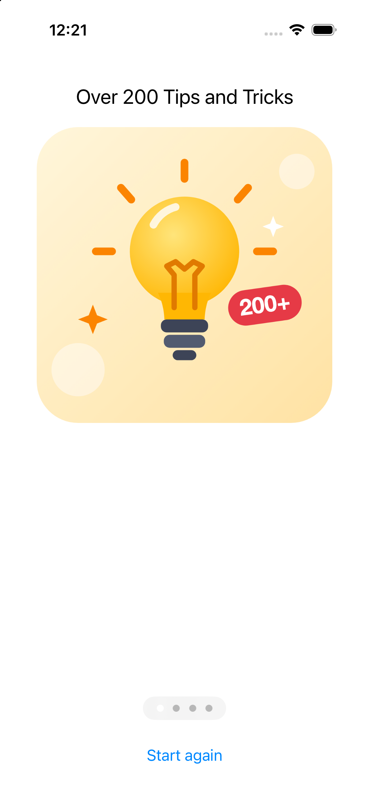
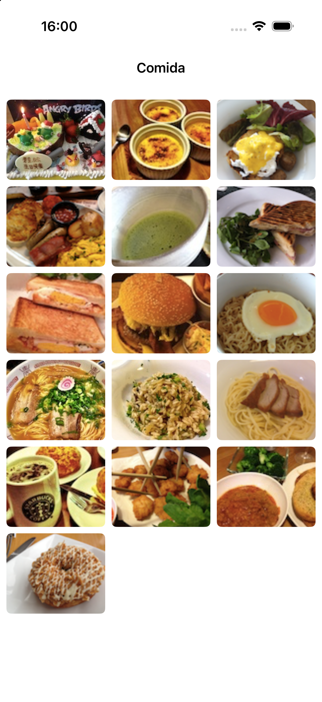
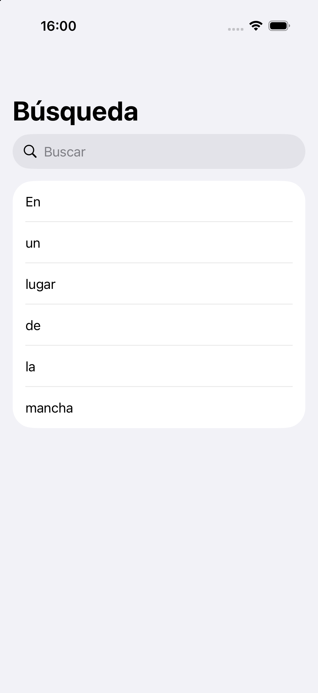

# 3- Contenedores y navegación

En esta sesión veremos tres formas de organizar contenido complejo: páginas por las que deslizarse, rejillas que se reorganizan según el espacio y tablas con buscador.

Las tres comparten un patrón que conviene reconocer: **un contenedor que coloca el contenido, y un estado que dice en qué punto estamos** (qué página se ve, qué texto se busca). Esa separación entre "qué se muestra" y "dónde estamos" es la que hace que no haya que escribir código de actualización para las vistas.

---

## Ejercicio 1 - Contenido paginado

Vamos a construir un tutorial de bienvenida de cuatro páginas por las que el usuario pasa deslizando, con los puntos indicadores abajo y un botón para volver al principio.



### TabView en modo página

`TabView` es el contenedor que normalmente dibuja una barra de pestañas debajo, pero cambiándole el estilo a `.page` se convierte en un contenedor paginado: las vistas que contiene pasan a ser páginas por las que el usuario avanza horizontalmente, con los puntos indicadores incluidos.

La página que se ve en cada momento se guarda en una variable de estado, que el `TabView` actualiza al deslizar y que nosotros podemos cambiar para saltar a otra página.

### Creando el proyecto

Crea un proyecto _iOS > App_ con **Interface: SwiftUI** llamado `ejercicio_pageview`, y añade a los _Assets_ las cuatro imágenes de
<a href="assets/descargas/imagenes_paginas.zip">imagenes_paginas.zip</a>
(`page1.png` … `page4.png`).

### La vista de una página

Como las cuatro páginas tienen la misma estructura y sólo cambian el título y la imagen, escribimos **una** vista parametrizada. Crea un fichero llamado  `PageContentView.swift`:

```swift
import SwiftUI

struct PageContentView: View {
    let titulo: String
    let imagen: String

    var body: some View {
        VStack(spacing: 20) {
            Text(titulo)
                .font(.title2)
                .multilineTextAlignment(.center)
            Image(imagen)
                .resizable()
                .scaledToFit()
                .padding(.horizontal, 40)
            Spacer()
        }
        .padding(.top, 30)
    }
}
```

### El contenedor paginado

Y ahora el `ContentView`, con código para completar (instrucciones abajo):

```swift
import SwiftUI

struct ContentView: View {
    let titulos = ["Over 200 Tips and Tricks",
                   "Discover Hidden Features",
                   "Bookmark Favorite Tip",
                   "Free Regular Update"]
    let imagenes = ["page1", "page2", "page3", "page4"]

    // a) Estado que recuerda en qué página estamos

    var body: some View {
        VStack {
            TabView(/* b) enlaza aquí la selección */) {
                // c) Una PageContentView por cada página, con su .tag
            }
            .tabViewStyle(.page(indexDisplayMode: .always))
            .indexViewStyle(.page(backgroundDisplayMode: .always))

            // d) Botón para volver a la primera página
        }
    }
}

#Preview {
    ContentView()
}
```

### Ejercicio

_a)_ Declara `@State private var paginaActual = 0`.

_b)_ Pasa la selección al `TabView` con `TabView(selection: $paginaActual)`. Fíjate en
el `$`: el `TabView` **escribe** en esa variable cuando el usuario desliza la pantalla, así que necesita un _binding_.

_c)_ Dentro del `TabView`, recorre las páginas con un `ForEach` sobre los índices y crea un `PageContentView` para cada una. Cada página necesita un `.tag(i)` para que la selección sepa a cuál corresponde:

```swift
ForEach(titulos.indices, id: \.self) { i in
    PageContentView(titulo: titulos[i], imagen: imagenes[i])
        .tag(i)
}
```

_d)_ Añade debajo del `TabView` un `Button("Start again")` que ponga `paginaActual` a cero. Envuélvelo en `withAnimation { ... }` para que la vuelta a la primera página sea animada en lugar de dar un salto.

_e)_ Ejecuta la app. Comprueba que puedes deslizar entre las cuatro páginas, que los puntos de abajo reflejan la página actual, y que el botón vuelve a la primera.


<!----!!! question "Para pensar"
    En ningún momento has escrito código que diga "cuál es la página siguiente" ni
    "cuál es la anterior". ¿De dónde saca el `TabView` esa información? Piensa en qué
    le has dado: una secuencia de vistas, cada una con su `tag`, y una variable que
    dice en cuál estamos.
--->

---

## Ejercicio 2 - Rejilla de contenido

Ahora construiremos una rejilla de imágenes que se reorganiza sola según el espacio disponible: más columnas en un iPad o en horizontal, menos en un iPhone en vertical. En _UIKit_ esto se implementaba mediante un `CollectionViewController`, pero en _SwiftUI_ es bastante más sencillo.



### Creando el proyecto

Crea un proyecto _iOS > App_ con **ISwiftUI** llamado
`ejercicio_collection`. Descarga <a href="assets/descargas/imagenes_comida.zip">imagenes_comida.zip</a> y arrastra las
16 imágenes (`1.jpg` … `16.jpg`) a los _Assets_.

### Rejillas en SwiftUI

Una rejilla se construye con `LazyVGrid` (o `LazyHGrid`) dentro de un `ScrollView`. El _lazy_ del nombre significa que las vistas sólo se crean cuando están a punto de aparecer en pantalla: con 16 imágenes da igual, pero con cientos es lo que mantiene la app fluida.

La rejilla se define con un array de columnas. Hay tres formas de especificarlas:

```swift
// Dos columnas de ancho fijo
[GridItem(.fixed(100)), GridItem(.fixed(100))]

// Dos columnas que se reparten el espacio
[GridItem(.flexible()), GridItem(.flexible())]

// Tantas columnas como quepan, de 100 puntos mínimo
[GridItem(.adaptive(minimum: 100))]
```

La tercera es la interesante: en lugar de decir cuántas columnas quieres, indicamos el ancho mínimo que debe tener cada una y dejamos que el sistema calcule cuántas caben. Así la rejilla se adapta sola al girar el dispositivo o al cambiar de dispositivo, sin código adicional.

### El código

```swift
import SwiftUI

struct ContentView: View {
    // a) Define aquí las columnas

    var body: some View {
        NavigationStack {
            ScrollView {
                // b) La rejilla con las 16 imágenes
            }
            .navigationTitle("Comida")
            .navigationBarTitleDisplayMode(.inline)
        }
    }
}

#Preview {
    ContentView()
}
```

### Ejercicio

_a)_ Declara las columnas como `let columnas = [GridItem(.adaptive(minimum: 100), spacing: 8)]`.

_b)_ Dentro del `ScrollView`, crea un `LazyVGrid(columns: columnas, spacing: 8)` y recorre las 16 imágenes con un `ForEach(1...16, id: \.self)`. Cada imagen se construye con `Image("\(i)")` y necesita:

```swift
.resizable()
.scaledToFill()
.frame(height: 100)
.clipped()
.cornerRadius(6)
```

Piensa por qué hace falta `.clipped()` junto a `.scaledToFill()`: prueba a quitarlo y
observa qué ocurre con las imágenes que no son cuadradas.

_c)_ Ejecuta la app en un iPhone y gíralo. Después lánzala en un iPad. Comprueba que el número de columnas cambia solo en los tres casos, sin que hayas escrito ningún código para ello.

_d)_ Cambia el `minimum:` de 100 a 150 y vuelve a probar. ¿Cuántas columnas salen ahora en el iPhone en vertical?

<!----
_e)_ **Para ampliar.** Haz que al pulsar una imagen se navegue a una pantalla de
detalle que la muestre a tamaño completo. Necesitarás envolver la rejilla en un
`NavigationStack` (ya lo está) y cada imagen en un `NavigationLink`. Crea una vista
`DetalleImagen` que reciba el nombre de la imagen.
--->

---

## Ejercicio 3 - Barra de búsqueda

Por último, vamos a crear una tabla con un buscador que filtra los resultados mientras se escribe.



### Buscar con `.searchable`

Añadir un buscador a una lista implica dos elementos:

1. Una variable de estado con el texto que el usuario va escribiendo.
2. Una lista que no muestra los datos completos, sino **el resultado de filtrarlos** por ese texto.

El modificador `.searchable` se encarga de dibujar la barra de búsqueda y de escribir en esa variable. El filtrado lo define el programador y es sólo una línea.

Lo importante es que **no hay dos listas**: no existe una lista "normal" y otra "de resultados". Hay una sola lista cuyo contenido depende del texto de búsqueda, que cuando está vacío son todos los datos.

### Creando el proyecto

Crea un proyecto _iOS > App_ con **Interface: SwiftUI** llamado
`ejercicio_searchbar`. 

### El código

```swift
import SwiftUI

struct ContentView: View {
    let contenido = ["En", "un", "lugar", "de", "la", "mancha"]

    // a) Estado con el texto que el usuario escribe

    // b) Propiedad calculada con los resultados filtrados
    var resultados: [String] {
        // ...
    }

    var body: some View {
        NavigationStack {
            List(resultados, id: \.self) { palabra in
                Text(palabra)
            }
            .navigationTitle("Búsqueda")
            // c) El modificador de búsqueda
        }
    }
}

#Preview {
    ContentView()
}
```

### Ejercicio

_a)_ Declara `@State private var textoBusqueda = ""`.

_b)_ Completa la propiedad calculada `resultados`. Si el texto de búsqueda está vacío debe devolver `contenido` entero. Si no, sólo las palabras que **empiezan** por ese texto, sin distinguir mayúsculas. Una pista:

```swift
guard !textoBusqueda.isEmpty else { return contenido }
return contenido.filter { $0.lowercased().hasPrefix(textoBusqueda.lowercased()) }
```

Fíjate en que `resultados` **no** es `@State`. Se recalcula solo cuando cambia `textoBusqueda`, así que no puede quedarse desincronizado.

_c)_ Añade el modificador de búsqueda:

```swift
.searchable(text: $textoBusqueda,
            placement: .navigationBarDrawer(displayMode: .always),
            prompt: "Buscar")
```

_d)_ Ejecuta la app y escribe `l` en el buscador. Deben quedar visibles sólo "lugar" y
"la".

!!! warning "Importante: `displayMode: .always`"
    Si dejas `.searchable(text: $textoBusqueda)` sin indicar `placement`, en **iOS 17** la barra de búsqueda queda **oculta** hasta que el usuario arrastra la lista hacia abajo. Como esta lista sólo tiene seis filas, no llega a desplazarse y la barra no aparecería nunca: la pantalla se vería sin buscador. En iOS 26 sí que sale por defecto.

    Es un buen ejemplo de por qué conviene probar también en la versión de iOS más baja que soporte tu app, y no fiarse del comportamiento por defecto cuando hay una opción explícita.

_e)_ Comprueba ese comportamiento tú mismo: quita el `placement` y lanza la app en un simulador con iOS 17. Después vuelve a añadirlo.

_f)_ **Para ampliar.** Añade `.searchSuggestions` para ofrecer sugerencias mientras se escribe, o cambia el filtro de "empieza por" a "contiene" usando `localizedCaseInsensitiveContains`. ¿Qué resultados salen ahora al escribir `a`?

<!----
!!! question "Para pensar"
    `resultados` es una propiedad calculada, no una variable guardada con `@State`.
    ¿Qué pasaría si la declararas como `@State private var resultados: [String] = []` y
    la rellenaras a mano cada vez que cambia el texto? Piensa en qué tendría que ocurrir
    para que la lista mostrara algo que no corresponde con lo escrito en el buscador.
-->
