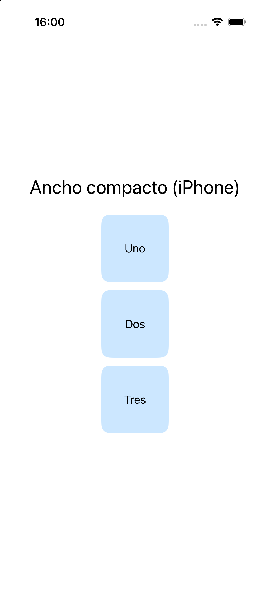
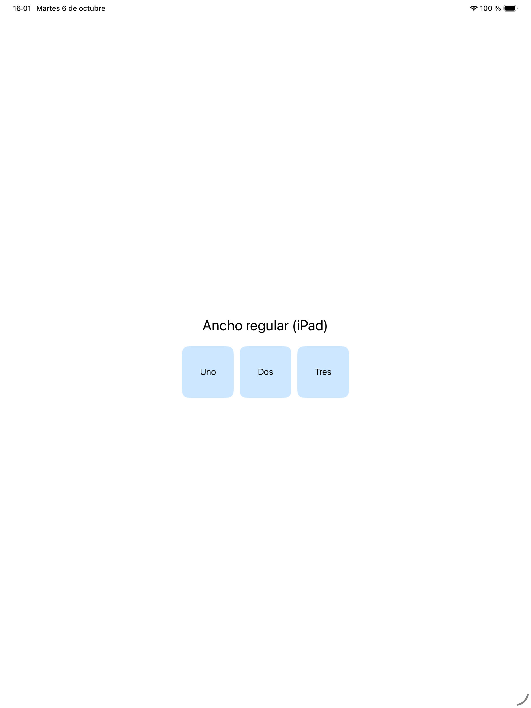
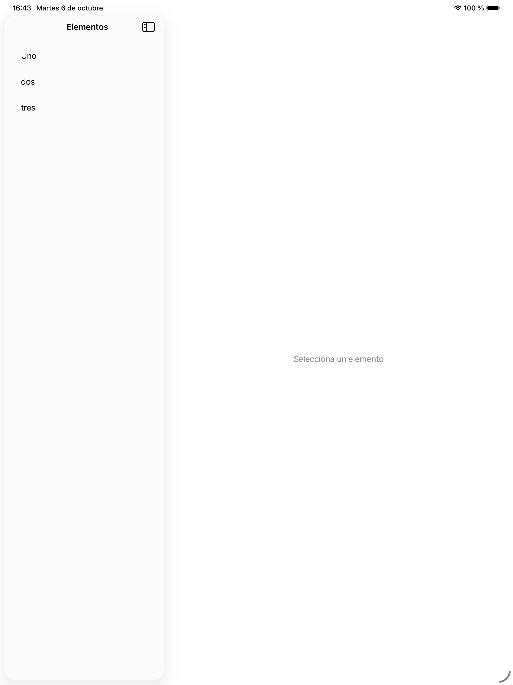
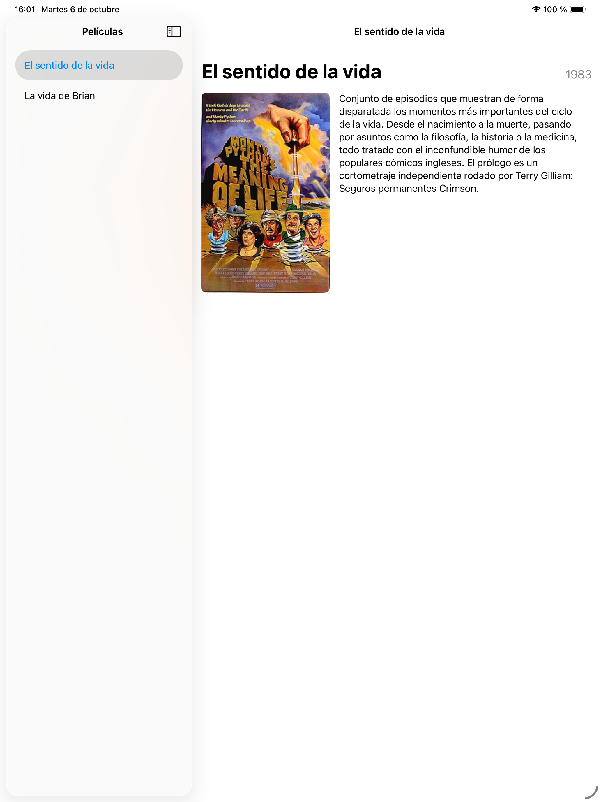

# 4- Diseño de aplicaciones universales

Una aplicación **universal** es la que funciona bien tanto en iPhone como en iPad,
aprovechando el espacio de cada uno en lugar de limitarse a estirar el diseño del
teléfono.

Para conseguirlo tenemos dos herramientas: las **_size classes_**, que nos dicen
cuánto espacio tenemos, y `NavigationSplitView`, un contenedor de varias columnas que
se adapta solo al dispositivo.

## Size classes

iOS no clasifica las pantallas por pulgadas sino por **_size classes_**: cada
dimensión puede ser `compact` (compacta) o `regular` (regular). Lo importante es que
dependen del espacio **realmente disponible**, no del modelo de dispositivo: un iPad
con dos apps en pantalla partida puede tener ancho compacto.

A grandes rasgos:

| Situación | Ancho | Alto |
|---|---|---|
| iPhone en vertical | compacto | regular |
| iPhone en horizontal (modelos pequeños) | compacto | compacto |
| iPad a pantalla completa | regular | regular |
| iPad en _Split View_ estrecho | compacto | regular |

En _SwiftUI_ se leen con `@Environment`:

```swift
@Environment(\.horizontalSizeClass) private var anchoClase
@Environment(\.verticalSizeClass) private var altoClase
```

y se usan para decidir la disposición:

```swift
if anchoClase == .compact {
    VStack { contenido }
} else {
    HStack { contenido }
}
```

La ventaja de resolverlo así es que la regla de adaptación queda **escrita en el
código**, a la vista de cualquiera que lea la vista y bajo control de versiones, en
lugar de ser un ajuste invisible en algún inspector.

!!! tip "ViewThatFits"
    Cuando la decisión no depende tanto del dispositivo como de si el contenido cabe o
    no, existe una alternativa más directa: `ViewThatFits` prueba las disposiciones que
    le des en orden y se queda con la primera que quepa.

    ```swift
    ViewThatFits(in: .horizontal) {
        HStack { imagen; texto }    // si cabe en horizontal, esta
        VStack { imagen; texto }    // si no, esta
    }
    ```

---

## Ejercicio 1 - Vista adaptable con size classes

Empezaremos con un ejercicio corto para ver las _size classes_ en funcionamiento.

| iPhone (ancho compacto) | iPad (ancho regular) |
|---|---|
|  |  |

### Creando el proyecto

Crea un proyecto _iOS > App_ con **Interface: SwiftUI** llamado `prueba_universal`. No
necesita imágenes.

### El código

```swift
import SwiftUI

struct ContentView: View {
    // a) Lee aquí la size class horizontal

    var esCompacta: Bool { /* b) */ }

    var body: some View {
        VStack(spacing: 24) {
            Text(esCompacta ? "Ancho compacto (iPhone)" : "Ancho regular (iPad)")
                .font(.title)
                .multilineTextAlignment(.center)

            let bloques = ["Uno", "Dos", "Tres"]
            // c) En columna si es compacta, en fila si es regular
        }
        .padding()
    }

    func bloque(_ texto: String) -> some View {
        Text(texto)
            .frame(width: 100, height: 100)
            .background(.tint.opacity(0.2), in: RoundedRectangle(cornerRadius: 12))
    }
}

#Preview {
    ContentView()
}
```

### Se pide

_a)_ Declara `@Environment(\.horizontalSizeClass) private var anchoClase`.

_b)_ Completa `esCompacta` para que devuelva `true` cuando `anchoClase` sea `.compact`.

_c)_ Según `esCompacta`, coloca los tres bloques en un `VStack` o en un `HStack`,
recorriéndolos con `ForEach(bloques, id: \.self) { bloque($0) }`.

_d)_ Lanza la app en un iPhone y en un iPad y comprueba que cambian tanto el texto
como la disposición.

_e)_ **Comprueba que no depende del dispositivo sino del espacio.** En el iPad, abre
la app en _Split View_ junto a otra y ve estrechándola. En cuanto el ancho pasa a ser
compacto, el diseño debe cambiar al de iPhone aunque sigas en un iPad.

_f)_ Añade debajo un texto pequeño que muestre el valor de las dos _size classes_
(horizontal y vertical) para poder verlas mientras giras el dispositivo. Tendrás que
leer también `verticalSizeClass` y convertir el valor a texto con un `switch`.

---

## NavigationSplitView

`NavigationSplitView` es un contenedor de dos (o tres) columnas. En pantallas anchas
muestra las columnas una al lado de otra; en un iPhone se **colapsa** solo y se
comporta como una navegación normal: primero la lista, y al seleccionar algo se navega
al detalle.

```swift
NavigationSplitView {
    // columna principal (la lista)
} detail: {
    // columna de detalle
}
```

La conexión entre lista y detalle se hace a través de la **selección**, no con código
de navegación:

```swift
struct ContentView: View {
    let contenido = ["Uno", "dos", "tres"]
    @State private var seleccionado: String?

    var body: some View {
        NavigationSplitView {
            List(contenido, id: \.self, selection: $seleccionado) { item in
                Text(item)
            }
            .navigationTitle("Elementos")
        } detail: {
            if let seleccionado {
                Text(seleccionado).font(.largeTitle)
            } else {
                Text("Selecciona un elemento").foregroundStyle(.secondary)
            }
        }
    }
}
```



Fíjate en cómo se comunican las dos columnas: **a través de un dato**, no llamando a
la otra vista. La lista escribe en `seleccionado`, y el detalle se dibuja a partir de
ese valor. Ninguna de las dos tiene una referencia a la otra.

Por eso la columna de detalle tiene que contemplar el caso de que no haya nada
seleccionado, que es como arranca la app. De ahí que `seleccionado` sea un opcional y
que haya un `else` con un mensaje.

---

## Ejercicio 2 - Películas

Este es el ejercicio final del libro y reúne casi todo lo visto: un modelo propio, una
lista maestra, una vista de detalle y una disposición que se adapta al espacio.



### Creando el proyecto

Crea un proyecto _iOS > App_ con **Interface: SwiftUI** llamado `ejercicio_peliculas`,
y añade a los _Assets_ la imagen de
<a href="assets/descargas/imagenes_peliculas.zip">imagenes_peliculas.zip</a>
(`sentido.jpg`).

### El modelo

Crea `Pelicula.swift`:

```swift
import Foundation

struct Pelicula: Identifiable, Hashable {
    let id = UUID()
    let titulo: String
    let caratula: String
    let fecha: String
    let descripcion: String
}

extension Pelicula {
    static let ejemplos = [
        Pelicula(titulo: "El sentido de la vida",
                 caratula: "sentido",
                 fecha: "1983",
                 descripcion: "Conjunto de episodios que muestran de forma disparatada los momentos más importantes del ciclo de la vida.")
        // a) Añade aquí al menos una película más
    ]
}
```

`Hashable` hace falta para poder usar la película como valor de selección de la
`List`.

### La vista de detalle

Crea `DetailView.swift`:

```swift
import SwiftUI

struct DetailView: View {
    let pelicula: Pelicula

    var body: some View {
        ScrollView {
            VStack(alignment: .leading, spacing: 16) {
                // b) Cabecera: título a la izquierda y año a la derecha

                // c) Carátula y descripción, en fila o en columna según quepa
            }
            .padding()
        }
        .navigationTitle(pelicula.titulo)
        .navigationBarTitleDisplayMode(.inline)
    }

    var caratula: some View {
        Image(pelicula.caratula)
            .resizable()
            .scaledToFit()
            .frame(maxWidth: 220)
            .cornerRadius(8)
    }

    var descripcion: some View {
        Text(pelicula.descripcion)
            .frame(maxWidth: 420, alignment: .leading)
    }
}
```

### La vista principal

Y `ContentView.swift`:

```swift
import SwiftUI

struct ContentView: View {
    let peliculas = Pelicula.ejemplos
    // d) Estado con la película seleccionada

    var body: some View {
        NavigationSplitView {
            // e) La lista con selección
        } detail: {
            // f) El detalle, o un texto si no hay nada seleccionado
        }
    }
}

#Preview {
    ContentView()
}
```

### Se pide

_a)_ Añade al menos una película más al array `ejemplos`. Puedes reutilizar la misma
carátula o añadir otras imágenes a los _Assets_.

_b)_ Escribe la cabecera del detalle: un `HStack` con el título
(`.font(.largeTitle.bold())`), un `Spacer(minLength: 12)` y el año
(`.font(.title3)`, `.foregroundStyle(.secondary)`). Usa
`HStack(alignment: .firstTextBaseline)` para que título y año queden alineados por la
línea base del texto.

!!! note "Por qué un `Spacer` y no un ancho fijo"
    Podrías colocar el año dándole al título un ancho fijo, pero entonces un título
    largo se saldría por encima del año, o quedaría cortado. Con `HStack` + `Spacer` el
    reparto lo hace el contenedor: el `Spacer` ocupa lo que sobra, y si no sobra nada
    el título se ajusta en varias líneas en lugar de solaparse. Pruébalo poniendo un
    título muy largo en una de tus películas.

_c)_ Coloca la carátula y la descripción usando `ViewThatFits(in: .horizontal)`, con un
`HStack` como primera opción y un `VStack` como segunda. Recuerda que ya tienes las dos
subvistas (`caratula` y `descripcion`) definidas como propiedades.

_d)_ Declara `@State private var seleccionada: Pelicula?`. Fíjate en que es
**opcional**: al arrancar no hay nada seleccionado.

_e)_ Escribe la lista con selección:

```swift
List(peliculas, selection: $seleccionada) { pelicula in
    Text(pelicula.titulo).tag(pelicula)
}
.navigationTitle("Películas")
```

El `.tag(pelicula)` es lo que conecta cada fila con el valor de selección.

_f)_ En el bloque `detail:`, muestra `DetailView(pelicula: seleccionada)` si hay
selección, y si no un `Text("Selecciona una película")` en color secundario. Usa
`if let seleccionada { ... } else { ... }`.

_g)_ Ejecuta la app **en un iPad** y comprueba que al pulsar una película aparece su
ficha en la columna derecha. Gíralo y observa cómo `ViewThatFits` cambia la
disposición de la carátula y la descripción.

_h)_ Ejecuta ahora la app **en un iPhone**. El `NavigationSplitView` se colapsa: verás
primero la lista, y al pulsar una película se navega a la ficha con un botón de volver.
No has escrito ni una línea para que eso ocurra.

_i)_ **Para ampliar.** Añade un buscador a la lista de películas con lo aprendido en la
sesión 3, de forma que se puedan filtrar por título. Acuérdate de usar
`placement: .navigationBarDrawer(displayMode: .always)`.

!!! question "Para pensar"
    `seleccionada` es de tipo `Pelicula?`, es decir, opcional. ¿Qué tendrías que
    cambiar en `ContentView` si quisieras que al arrancar apareciese ya seleccionada la
    primera película? ¿Y qué problema tendrías si la lista pudiera estar vacía?

---

<!---

## Resumen del libro

A lo largo de estas cuatro sesiones hemos visto:

* **Sesión 1**: vistas, modificadores, contenedores (`VStack`/`HStack`/`ZStack`),
  estado (`@State`), _bindings_ (`$`), listas y navegación.
* **Sesión 2**: las guías de estilo de Apple y el rediseño _Liquid Glass_, y cómo
  personalizar filas de lista y barras **a través de los puntos de personalización
  soportados**.
* **Sesión 3**: contenido paginado con `TabView`, rejillas adaptativas con
  `LazyVGrid` y búsqueda con `.searchable`.
* **Sesión 4**: _size classes_, `ViewThatFits` y `NavigationSplitView` para
  aplicaciones universales.

La idea que atraviesa todo el libro es siempre la misma: **se describe qué debe verse
en función del estado, y el sistema se encarga del resto**. Cada vez que te encuentres
escribiendo código para «actualizar» algo en pantalla, merece la pena parar y
preguntarse qué dato debería cambiar en su lugar.
-->